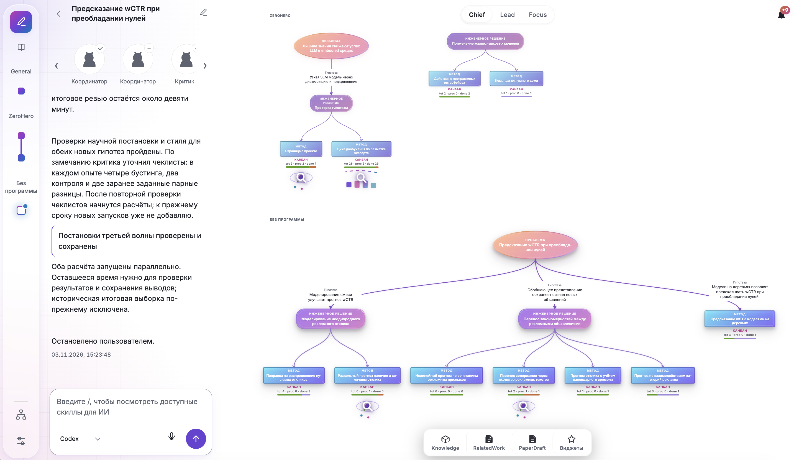

<h1 align="center">ResearcherOS</h1>

<p align="center"><strong>Исследуйте вместе с AI-агентами. Сохраняйте путь от вопроса до вывода.</strong></p>

ResearcherOS связывает дерево исследования, эксперименты, отчёты и базу знаний в одном рабочем пространстве. Подключите репозиторий проекта, сформулируйте вопрос и проведите первый эксперимент вместе с агентом.

<p align="center">
  <a href="#быстрый-старт">Установка</a> ·
  <a href="#от-вопроса-до-вывода">Как это работает</a> ·
  <a href="https://cognitiveaisystems.github.io/ResearcherOS/">Сайт</a> ·
  <a href="docs/README.md">Документация</a> ·
  <a href="https://github.com/CognitiveAISystems/ResearcherOS/issues">Обратная связь</a>
</p>

> Канал `main`. Для знакомства с предварительными изменениями откройте [ветку beta](https://github.com/CognitiveAISystems/ResearcherOS/tree/beta).



*Дерево связывает исследовательскую проблему, гипотезы и методы проверки. У методов есть канбан с экспериментами.*

## От вопроса до вывода

Вместе с агентом пройдите один цикл исследования:

| Шаг | Что вы делаете | Что остаётся в проекте |
|-----|----------------|------------------------|
| Сформулируйте вопрос | Опишите проблему и гипотезу в дереве | Связь между вопросом и методом проверки |
| Подготовьте эксперимент | Создайте карточку и заранее задайте критерий результата | План проверки в канбане |
| Проведите проверку | Запустите эксперимент для карточки через `/run` | Результаты и отчёт |
| Сохраните вывод | Подготовьте с агентом вывод по результатам | Ответ на исследовательский вопрос со ссылкой на отчёт |

Пройдите [первое исследование на рекламных данных](https://github.com/ZoyaV/researcheros_starter_kit): восемь заданий с готовыми сообщениями агенту и [руководство в PDF](https://github.com/ZoyaV/researcheros_starter_kit/blob/main/guide/starter-kit.pdf).

## Возможности

- **Дерево исследования.** Храните проблему, гипотезы и методы проверки вместе.
- **Эксперименты.** Планируйте работу в канбане и сохраняйте отчёты по карточкам.
- **База знаний.** Возвращайтесь к полученным выводам и отчётам, на которых они основаны.
- **Научная литература.** Работайте со статьями из локальной библиотеки, arXiv и Zotero; готовьте тематический обзор.
- **Подготовка статей.** Собирайте материалы исследования для совместной работы над публикацией.
- **Git-синхронизация.** Сохраняйте дерево, отчёты и исследовательские материалы в Git.

## Быстрый старт

### Что понадобится

- [Git](https://git-scm.com/downloads) и [Git LFS](https://git-lfs.com/).
- Установленный и настроенный агент командной строки (CLI), который вы будете использовать в ResearcherOS.
- Git-репозиторий вашего исследовательского проекта хотя бы с одним коммитом.

### 1. Получите приложение

```bash
git lfs install
git clone --branch main https://github.com/CognitiveAISystems/ResearcherOS.git ReseachOS
cd ReseachOS
git lfs pull
```

Запустите установщик для своей системы из папки `installers`:

| macOS | Windows | Linux |
|:-----:|:-------:|:-----:|
| [Установить ResearcherOS.command](installers/Установить%20ResearcherOS.command) | [ResearcherOS Setup 0.1.0.exe](installers/ResearcherOS%20Setup%200.1.0.exe) | [ResearcherOS-0.1.0.AppImage](installers/ResearcherOS-0.1.0.AppImage) |

Установщик macOS загружает зависимости и собирает приложение; нужен интернет. Windows и Linux используют готовые сборки. Большие файлы установщиков хранятся через Git LFS: используйте клонирование, поскольку их наличие в Download ZIP зависит от настроек GitHub.

<details>
<summary>Установка и обновление на macOS</summary>

### macOS

1. В папке `installers` дважды щёлкните по файлу **`Установить ResearcherOS.command`**.
2. Дождитесь окончания установки. Установщик откроет терминал, загрузит зависимости и соберёт приложение; нужен интернет.
3. После установки приложение откроет мастер первоначальной настройки.

Приложение устанавливается в `~/Applications/ResearcherOS.app`. Если macOS блокирует первый запуск, разрешите его в разделе **Системные настройки → Конфиденциальность и безопасность**.

Чтобы обновить приложение и пройти настройку заново, закройте его, выполните `git pull` в папке репозитория и снова запустите установщик. Ранее подключённые проекты сохранятся. Подробности: [установка на Mac](docs/site/start/mac.html).
</details>

<details>
<summary>Установка на Windows</summary>

### Windows

1. В папке `installers` запустите `ResearcherOS Setup 0.1.0.exe`.
2. Следуйте шагам установщика, затем откройте ResearcherOS.
</details>

<details>
<summary>Установка на Linux</summary>

### Linux

Сборка предназначена для Intel/AMD x86_64 с glibc 2.35 или новее (Ubuntu 22.04 и новее). Проверена на Pop!_OS 22.04; другие версии проверяются отдельно.

1. В папке `installers` в свойствах файла `ResearcherOS-0.1.0.AppImage` разрешите выполнение как программы.
2. Запустите файл и пройдите первоначальную настройку ResearcherOS.
</details>

### 2. Подключите проект

Откройте приложение и пройдите мастер первоначальной настройки. Выберите существующую папку `tree` с исследованиями или подключите локальный Git-репозиторий проекта. Если код находится только на сервере, сначала клонируйте его на компьютер.

Приложение использует готовую папку `tree` на прежнем месте. Для подключаемого проекта мастер настраивает отдельное хранение исследовательских материалов рядом с кодом.

### 3. Проведите первый эксперимент

1. Выберите метод в дереве и добавьте в его канбан карточку эксперимента. Опишите вопрос и критерий результата.
2. Запустите эксперимент для этой карточки через `/run`.
3. По завершении подготовьте с агентом отчёт и сохраните вывод в дереве.
4. Создайте коммит с деревом, отчётом и материалами исследования.

Затем можно подключить Zotero, подготовить обзор литературы и разобрать отдельную статью. Подробный маршрут: [первое исследование](docs/human/getting-started.md).

## Статус и ограничения

- **macOS:** установка собирает приложение локально. Обновление: закройте приложение, выполните `git pull` и повторно запустите установщик; подключённые проекты сохранятся.
- **Windows:** сборка прошла автоматическую проверку установки и запуска.
- **Linux:** Intel/AMD x86_64, glibc 2.35 или новее. На Pop!_OS 22.04 проверены запуск AppImage, первоначальная настройка и её сохранение после перезапуска. Другие системы и обновление поверх прежней установки требуют отдельной проверки.
- **AI-агент:** для работы с агентом требуется отдельно установленный и настроенный CLI.

## Документация и участие

- [Документация проекта](docs/README.md) и [путеводитель для нового пользователя](docs/human/getting-started.md).
- [Сообщить об ошибке или предложить улучшение](https://github.com/CognitiveAISystems/ResearcherOS/issues). Укажите ветку, ОС, шаги воспроизведения и ожидаемый результат.
- Для изменений в коде начните с [инструкций репозитория](AGENTS.md).

## Новости проекта

| Дата | Новость |
|------|---------|
| 2026-07-24 | **Виджеты.** Собственные панели в рабочем пространстве проекта. |
| 2026-07-22 | **Обзор литературы.** Статьи из локальной библиотеки, arXiv и Zotero; тематические группы и черновик раздела обзора связанных работ. |
| 2026-07-22 | **Каталог навыков Hub.** Обмен пакетами навыков агента через публичные проекты. |
