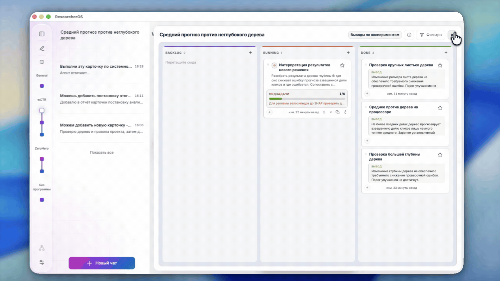

<h1 align="center">
  
</h1>

<p align="center"><strong>Исследуйте вместе с AI-агентами. Сохраняйте путь от вопроса до вывода.</strong></p>

ResearcherOS связывает дерево исследования, эксперименты, отчёты и базу знаний в одном рабочем пространстве. Подключите репозиторий проекта, сформулируйте вопрос и проведите первый эксперимент вместе с агентом.

<p align="center">
  <a href="#возможности">Возможности</a> ·
  <a href="#установка">Установка</a> ·
  <a href="#starterkit">StarterKit</a> ·
  <a href="#новости-проекта">Новости</a>
</p>

[](https://youtu.be/FZC6wRcdMI8)

[Смотреть видео на YouTube](https://youtu.be/FZC6wRcdMI8)

## Возможности

- **Дерево исследования.** Храните проблему, гипотезы и методы проверки вместе.
- **Эксперименты.** Планируйте работу в канбане и сохраняйте отчёты по карточкам.
- **База знаний.** Возвращайтесь к полученным выводам и отчётам, на которых они основаны.
- **Научная литература.** Работайте со статьями из локальной библиотеки, arXiv и Zotero; готовьте тематический обзор.
- **Подготовка статей.** Собирайте материалы исследования для совместной работы над публикацией.
- **Git-синхронизация.** Сохраняйте дерево, отчёты и исследовательские материалы в Git.

## Установка

> [!NOTE]
> **Перед началом подготовьте:**
> - **Git** — [установить](https://git-scm.com/downloads).
> - **Одного AI-агента** — установите и настройте [Codex CLI](https://developers.openai.com/codex/cli/), [Cursor CLI](https://cursor.com/docs/cli/installation) или [OpenCode CLI](https://opencode.ai/docs/).
> - **Проект** — локальный Git-репозиторий хотя бы с одним коммитом.

### Скачайте подходящую версию ResearcherOS [↗](https://github.com/CognitiveAISystems/ResearcherOS/releases "Открыть GitHub Releases")

| Ваш компьютер | Что скачать | Что сделать |
|---|---|---|
| **Mac · Apple Silicon** (M1 и новее) | DMG с `arm64` в имени | Перенести приложение в «Программы» |
| **Mac · Intel** | DMG с `x64` в имени | Перенести приложение в «Программы» |
| **Windows** | `.exe` | Запустить установщик |
| **Linux · x86_64** | `.AppImage` | Разрешить выполнение и открыть файл |

**Подробности для вашей системы:**

<details>
<summary><strong>macOS — установка, первый запуск и скрипт</strong></summary>

1. Откройте DMG для своего процессора и перенесите `ResearcherOS.app` в папку «Программы» (`Applications`). Если нет прав на общую папку, используйте `~/Applications`.
2. Запустите приложение и пройдите первоначальную настройку.
3. Если macOS блокирует первый запуск, откройте **Системные настройки → Конфиденциальность и безопасность** и разрешите запуск скачанного приложения.

Сборки используют локальную ad-hoc-подпись без сертификата Developer ID и notarization Apple. Проверка запуска в CI не проверяет Gatekeeper после скачивания через браузер на отдельном Mac.

Для обновления закройте приложение и замените его новой версией из того же канала. Настройки и исследовательские данные хранятся отдельно; обновление поверх прежней установки ещё требует ручной проверки.

**Альтернатива: установка скриптом.** Клонируйте репозиторий и запустите `installers/Установить ResearcherOS.command` двойным щелчком:

```bash
git clone --branch main https://github.com/CognitiveAISystems/ResearcherOS.git ReseachOS
cd ReseachOS
```

Скрипт загрузит зависимости и соберёт приложение в `~/Applications/ResearcherOS.app`; нужен интернет. Для обновления выполните `git pull` и снова запустите скрипт. Подробности: [установка на Mac](docs/site/start/mac.html).
</details>

<details>
<summary><strong>Windows — установка</strong></summary>

1. Скачайте `.exe` выбранного релиза и запустите его.
2. Следуйте шагам установщика, затем откройте ResearcherOS.
</details>

<details>
<summary><strong>Linux — установка и требования</strong></summary>

Сборка предназначена для Intel/AMD x86_64 с glibc 2.35 или новее (Ubuntu 22.04 и новее). Проверена на Pop!_OS 22.04; другие версии проверяются отдельно.

1. Скачайте `.AppImage` выбранного релиза и в свойствах файла разрешите выполнение как программы.
2. Запустите файл и пройдите первоначальную настройку ResearcherOS.
</details>

<details>
<summary><strong>Обновление приложения</strong></summary>

Закройте ResearcherOS и установите новую версию из того же канала. На macOS замените приложение в папке «Программы». Для установки скриптом выполните `git pull` и повторно запустите скрипт.

Настройки и исследовательские данные хранятся отдельно от приложения. Перед первым обновлением сохраните копию данных: обновление поверх прежней установки ещё требует ручной проверки.

</details>

## StarterKit

[StarterKIT](https://github.com/ZoyaV/researcheros_starter_kit) — учебный набор, на котором можно познакомиться с возможностями ResearcherOS и попробовать их на практике.

## Новости проекта

| Дата | Новость |
|------|---------|
| 2026-11-10 | **Готовые установщики.** ResearcherOS можно скачать для macOS, Windows и Linux из GitHub Releases. |
| 2026-11-10 | **Редактор отчётов.** Таблицы, списки задач и формулы можно добавлять и редактировать в интерфейсе. |
| 2026-11-10 | **Навыки проекта.** Инструкции для агента можно создавать и привязывать к карточке, методу или всему дереву. |


<details>
<summary>Предыдущие новости</summary>

| Дата | Новость |
|------|---------|
| 2026-11-09 | **ACP-like подключение агентов.** Единый интерфейс для работы с агентами в чате ResearcherOS. |
| 2026-11-09 | **Интеграция OpenCode.** OpenCode доступен как агент чата и исполнитель исследовательских задач. |
| 2026-11-02 | **Инженерные деревья.** Инженерные решения можно представлять в дереве вместе с методами и задачами. |
| 2026-07-24 | **Виджеты.** Собственные панели в рабочем пространстве проекта. |
| 2026-07-22 | **Обзор литературы.** Статьи из локальной библиотеки, arXiv и Zotero; тематические группы и черновик раздела обзора связанных работ. |
| 2026-07-22 | **Каталог навыков Hub.** Обмен пакетами навыков агента через публичные проекты. |

</details>

## Поддержка проекта

<a href="https://fund.mipt.ru/">
  
</a>

Проект реализуется при поддержке [Фонда целевого капитала МФТИ](https://fund.mipt.ru/).

Узнайте, [как работает фонд](https://t.me/miptfund/879), следите за его новостями в [Telegram](https://t.me/miptfund) и [ВКонтакте](https://vk.com/miptfund) или [сделайте вклад](https://fund.mipt.ru/donate/).
